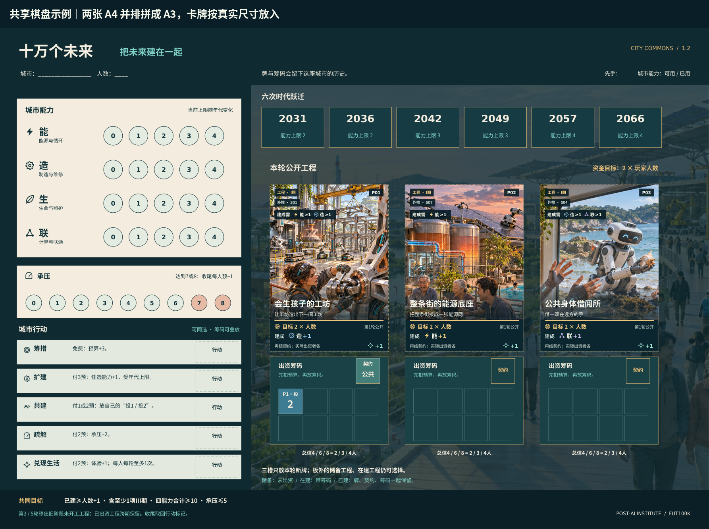

# Boardgame Lab | 后AI研究所桌游实验室

**Tabletop and browser-based future-life experiments by Post-AI Institute.**

从现实条件出发，设计能够亲身经历不同未来的桌面与在线实验。

本项目由后AI研究所维护，仓库为 [PostAI-Inst/boardgame-lab](https://github.com/PostAI-Inst/boardgame-lab)。源码、规则与可打印文件按游戏归档；发行版本和媒体附件以实际 [Releases](https://github.com/PostAI-Inst/boardgame-lab/releases) 为准。

## 在线实验：后AI生活须知

[**进入在线游戏**](https://postai-inst.github.io/boardgame-lab/games/postai-rules/) · [游戏说明](games/postai-rules/README.md) · [研究与创作设计](games/postai-rules/docs/design.md)

**《本人仍在此处》**是一款单人规则怪谈与未来生活调查游戏。城市确认家人已经全部到齐，但弟弟本人没有出现。你需要走进能重组的社区，调查现场、核对授权和照护记录，并决定一座城市怎样接住那些落在规则之外的人。

- 六章主线、18 个现场、3 种结局；另有 12 个独立怪谈，共 39 个可抵达的结局。
- 六类动态场景、可点击的调查点、规则与证据手册、具有条件和代价的行动。
- 六种制度原型、研究来源与明确的推演边界。
- 浏览器直接运行，无账号；本机自动存档，支持 JSON 导出与导入、环境音、减少动态和放大文字。

这是预写分支的可玩原型，不调用在线大模型，也不上传玩家选择。手机与桌面均可访问。

## 首个实验：十万个未来 FUT100K

[**十万个未来 · 未来已有人居住**](games/fut100k/README.md) 是一个 2–4 人、六幕（2031／2036／2042／2049／2057／2066）的合作建设与未来生活叙事桌游。



从 **[规则](games/fut100k/output/pdf/十万个未来_规则与城市手册.pdf)**、**[99 张九宫格卡](games/fut100k/output/pdf/十万个未来_九宫格图标卡牌_A4_每页9张.pdf)**、**[棋盘和筹码](games/fut100k/output/pdf/十万个未来_棋盘玩家板与筹码_A4.pdf)**、**[故事回声册](games/fut100k/output/pdf/十万个未来_故事与回声册.pdf)** 开始。亦可下载 [29 页完整打印包](games/fut100k/output/pdf/十万个未来_未来已有人居住_完整打印版.pdf)。

## 仓库结构

```text
games/
  catalog.json                      # 项目目录及版本
  postai-rules/
    index.html                      # 后AI生活须知在线游戏
    app.js / engine.js / scene.js    # 界面、叙事状态机与动态场景
    content/                        # 主线、12 个怪谈与研究档案
    tests/                          # 结局可达性、条件与存档验证
    docs/                           # 未来学机制与创作设计
  fut100k/
    README.md                       # 开桌与打印指引
    data/                           # 结构化规则、城市、场景与回声
    source/                         # PDF 生成器及矢量绘制源代码
    assets/                         # 当前插画；concept-atlases 为探索图
    output/pdf/                     # 可直接打印的 1.2 版 PDF
    docs/                           # 世界观、工作坊、研究依据及历次版本
    media/                          # 宣传图、字幕、配音试听与视频说明
    scripts/                        # 仓库数据和文件检查
```

## 开发与贡献

- 当前版本为 **playtest prototype**：素材齐全，可打印；尚缺真实玩家的平衡验证。
- 核心规则先用确定性数据与校验保持一致；插画与讲述不自行改写数值。
- 优先提交 [试玩反馈 Issue](.github/ISSUE_TEMPLATE/playtest.yml)：记录玩家人数、城市、回合、实际选择和可重现的问题。
- 可编辑工程与生成方式见 [游戏文档](games/fut100k/README.md)。
- 本仓库未自动授予第三方重用、改编或商用许可；开放授权方案需要权利与来源审核，见 [版权与素材说明](RIGHTS_AND_PROVENANCE.md)。

## 关于版本

- 首次试玩发布计划使用标签 `v0.1.0-playtest`；发行状态与可用附件请查看 [Releases](https://github.com/PostAI-Inst/boardgame-lab/releases)。
- 《十万个未来》桌游文件：**满画幅 1.2**。
- 《明日编年》讲解视频：**MeloTTS 女声精修版**；完整 MP4 建议放到 GitHub Release，而不是纳入 Git 历史。
