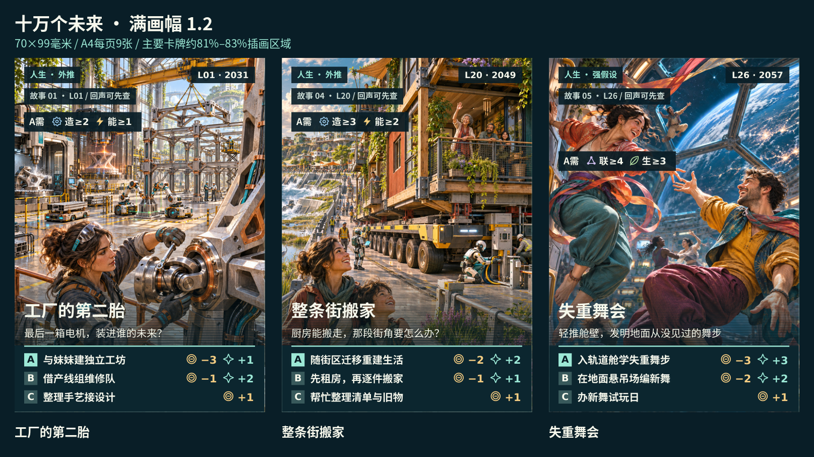

# 十万个未来：未来已有人居住

**FUT100K · A City Yet to Be Lived In**  
后AI研究所 / Post-AI Institute · print-and-play v1.2 (待真人桌测)



## 这是什么游戏？

2–4 人合作建设与生活叙事。全桌从2031年出发，穿过2036、2042、2049、2057直到2066年。每轮每位玩家面对未来生活邀约，进行两次城市行动，参与公共工程，接收上一年代留下的回声。技术可用与真正生活在其中不是一回事；每座城市采用不同扩散/制度假设。

## 快速开桌（建议先打印以下四个）

| 内容 | 文件 | 份数与提示 |
| --- | --- | --- |
| 完整规则 | [规则与城市手册](output/pdf/十万个未来_规则与城市手册.pdf) | 6页，可屏幕阅读 |
| 卡牌 | [九宫格卡牌 PDF](output/pdf/十万个未来_九宫格图标卡牌_A4_每页9张.pdf) | 11页 A4，99张（96正式＋3辅助） |
| 桌面组件 | [共享棋盘、玩家板、筹码](output/pdf/十万个未来_棋盘玩家板与筹码_A4.pdf) | 5页；双人只需4页 |
| 剧情与延迟效果 | [故事与回声册](output/pdf/十万个未来_故事与回声册.pdf) | 7页，可屏幕阅读；游玩时必备 |

**一包打全：** [29页完整打印版](output/pdf/十万个未来_未来已有人居住_完整打印版.pdf)。如果可以直接印A3，可用 [A3棋盘](output/pdf/十万个未来_共享城市棋盘_A3.pdf) 替代前两页桌面组件。牌面70×99毫米，A4每页3×3，满页裁切、无额外出血；无边距要求打印设备支持。

## 游戏中的系统

- **四条城市能力**：能（能源/水热）、造（制造与验证）、生（生命与照护）、联（计算与远端连接）。另有公共承压。
- **玩家行动**：筹措（+3预算）、扩建（−3预算，一轨+1）、共建（投1或2预算）、疏解（−2预算，承压−2）、兑现生活（−2预算，体验+1）。
- **一轮次序**：收入及上轮回声 → 时代与看二留一邀约 → 第一圈城市行动 → 同时选生活A/B/C → 第二圈行动 → 收尾。
- **项目建设**：每项工程需资金2×玩家数且满足能力门槛；首位出资者选公共/合伙/专属契约，出资者记录真实成本和回报。
- **两层结局**：共同城市达成条件与个人愿景/体验分别结算。

## 素材与再生成

`data/` 内有全部36张人生场景及108条回声、18项工程、10城、8居民、8愿景、6时代、出品检查与研究边界。`assets/` 是插画与标识；`source/` 是程序。

```bash
python3 -m pip install -r source/requirements.txt
python3 source/build_fullart.py
```

运行使用系统提供的 Noto Sans CJK SC 等字体；**仓库不包含字体文件**。首次生成之前检查 `source/build_pdf.py` 的字体路径。输出位于 `output/pdf/`。

当前 PDF 作为经检查的发行版一起托管，生成环境变更后应复核页数、卡牌边界和中文字体。自动结构检查：

```bash
python3 scripts/validate_repo.py
```

## 专题文档

- [十座城市与制度差异](docs/03_十城设定与技术条件.md)
- [完整规则与操作](docs/02_完整规则与操作.md)
- [生活场景与分支回声](docs/04_生活场景与分支回声.md)
- [工程、角色、愿景与时代](docs/05_工程角色愿景与时代.md)
- [Workshop主持与试玩](docs/06_Workshop主持与试玩.md)
- [影像、印刷与出品规范](docs/07_影像印刷媒体与出品规范.md)
- [硬未来学依据与外推边界](docs/08_研究依据与外推边界.md)
- [版本沿革](docs/09_版本沿革与素材档案.md)

## 影像

**《十万个未来｜明日编年》** 女声精修版 6分57秒。为避免将每次视频导出反复写入 Git 历史，1080p/720p MP4 请作为 Release 附件发布；本库保留 [中文字幕](media/十万个未来_明日编年_中文字幕.srt)、[讲解导览](media/十万个未来_明日编年_讲解导览.md) 与 [45秒女声试听](media/十万个未来_明日编年_女声试听_45秒.mp3)。尚未建立 Release，因此没有填写不存在的视频下载地址。

## 研究与使用说明

这里的未来年代是**条件情景**，不代表技术实现的时间预测。图像是生成的情景创作，不应被误认为真实部署照片。此原型尚未真人桌测；试玩反馈仅用于改进规则，任何正式研究数据收集应先说明目的并征得同意。
