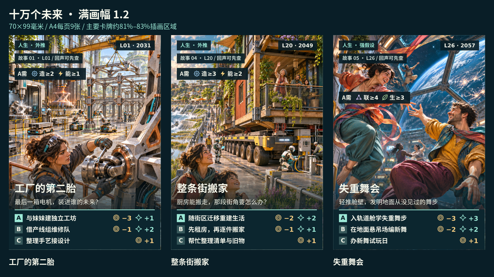

# 视频、卡牌、棋盘与可编辑素材

## 当前官方影像

**《十万个未来｜明日编年》女声精修**，副标“2031—2066 · 六个时代，一座城，无数种人生”。成片6分57秒；1080p/720p、24fps，普通话MeloTTS中文预设女声 `ZH`。字幕与音轨已同步，背景为原创电子配乐《明天正在生成》。本片采用 Noto Sans CJK SC 黑体（粗体标题、常规正文与字幕）。

- [1080p现场投屏（Release待发布说明）](../media/RELEASE_ASSETS.md)
- [720p转发版（Release待发布说明）](../media/RELEASE_ASSETS.md)
- [中文SRT字幕](../media/十万个未来_明日编年_中文字幕.srt)
- [45秒女声试听](../media/十万个未来_明日编年_女声试听_45秒.mp3)
- [影片海报](../media/十万个未来_明日编年_海报.jpg)
- [视频讲解导览](../media/十万个未来_明日编年_讲解导览.md)

本次发布基线提供成片、字幕、讲解导览与女声试听，不包含独立的视频制作工程 ZIP。模型本身和字体文件不随此包分发；完整 MP4 的发布位置见 [Release 素材说明](../media/RELEASE_ASSETS.md)。

## 桌游可打印文件

- [29页完整打印版](../output/pdf/十万个未来_未来已有人居住_完整打印版.pdf)——规则1–6、组件7–11、九宫格卡牌12–22、故事册23–29。
- [卡牌11页 每页9张](../output/pdf/十万个未来_九宫格图标卡牌_A4_每页9张.pdf)——卡牌70×99mm。
- [A4棋盘玩家板与筹码](../output/pdf/十万个未来_棋盘玩家板与筹码_A4.pdf)——5页。
- [A3整张共享城市棋盘](../output/pdf/十万个未来_共享城市棋盘_A3.pdf)。
- [规则手册6页](../output/pdf/十万个未来_规则与城市手册.pdf)。
- [故事与回声册7页](../output/pdf/十万个未来_故事与回声册.pdf)。

## 插画与预览

完整游戏源文件已在本仓库的 `data/`、`source/` 与 `assets/` 目录中，详见 [游戏入口](../README.md)。原始 1.2 素材 ZIP 列入独立 Release 媒体包，见 [Release 素材说明](../media/RELEASE_ASSETS.md)。

## 印刷约束

A4竖版，每张70×99毫米，3列×3行、满版无卡间白缝、无额外出血。裁线距左边70、140毫米，距顶部99、198毫米。需要支持原尺寸100%无边距打印，关闭自动放大；不支持无边距的打印机可能裁掉页面外沿。

## 交付与出品质量原则

- **文字：** 无例外优先采用合适的中文黑体；标题用Noto Sans CJK SC Bold，正文及字幕Regular。
- **声音：** 男声版为历史版本，不用于默认播映；当前MeloTTS女声以完整句子、自然停顿解释规则。
- **画面：** 不以卡牌文字堆满屏幕；先展示场景，再展示选项和出资数值，保留视觉焦点。
- **一致性：** 游戏改版后，故事册、卡牌数据、规则和视频数值必须一起更新。
- **媒体许可：** 游戏素材包含生成图与项目原创音轨；研究引用需要保留各自来源。不将游戏设定标成已实现技术事实。

## Pages原生媒体注意

这个包是离线素材目录。要在 ChatGPT Pages 内真正内嵌 MP4/MP3/PDF/PNG，应使用 Pages 的媒体上传/附件功能并得到有效原生媒体引用，不能将本地相对路径当成已上传。此包没有执行 Pages 写入。
